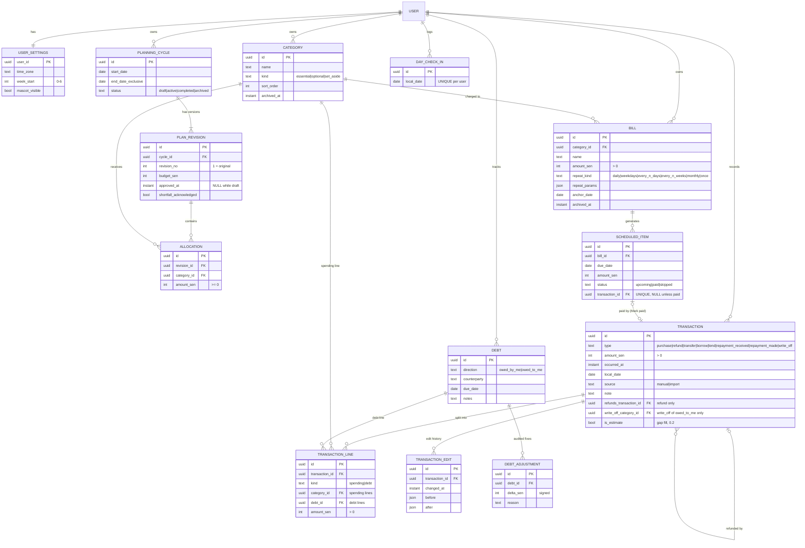

# Brokely — Logical Data Model (ERD) v0.1

Status: **draft for review** (Phase 1). Source: SRS v1.1 section 7, updated with decisions D-01…D-19 and R-01…R-10.
This is the *logical* model shared by the phone (SQLite) and the server (PostgreSQL). Physical details
(indexes, exact SQL types) follow in the Drizzle schemas.

## 1. Design principles

1. **Facts are stored; numbers are derived.** We store what happened (transactions, allocations, check-ins). Totals,
   remaining amounts, coverage, forecast, debt status and mascot level are always computed by `packages/domain`,
   never stored. Stored totals drift; derived ones can't.
2. **Money is `INTEGER` sen**, always > 0 on transactions and lines (R-04). The only signed amount is a debt adjustment.
3. **Dates that people see are local dates** (`TEXT 'YYYY-MM-DD'`), so a cycle or a "logged day" never shifts when the
   time zone changes (BR-03). Moments are UTC instants (`occurred_at`, `created_at`).
4. **Every synced row** has: `id` (UUIDv7, made on the phone), `user_id` (NULL on the phone in local-only mode, D-05),
   `version`, `created_at`, `updated_at`, `deleted_at` (delete marker, FR-SYNC-09). The server adds `server_seq`.
5. **Membership by date is derived, not stored.** A transaction or scheduled item belongs to the cycle whose dates
   contain its `local_date` (BR-04). This avoids broken links when a cycle's dates are edited.
6. **History is append-only where it matters.** Approved plan revisions are never edited; a change makes a new
   revision (D-03, D-19). Transaction edits are recorded in `transaction_edit`.

## 2. Diagram (release 0.1)



Sync-only tables (not shown): `outbox_operation` and `sync_state` on the phone; `processed_operation` on the server.

## 3. Tables

### Plan
| Table | Key columns | Constraints and rules |
|---|---|---|
| `planning_cycle` | `start_date`, `end_date_exclusive`, `status` | `start_date < end_date_exclusive`. The user enters an inclusive end date; stored as end + 1 day (BR-03). **No two cycles with status `active` or `completed` may share a date** (BR-05 extended by D-18: completed cycles still own their dates). Drafts and archived cycles may overlap. Postgres: `EXCLUDE USING gist (user_id WITH =, daterange(start_date, end_date_exclusive) WITH &&) WHERE status IN ('active','completed')`. SQLite: checked by the domain before saving. |
| `plan_revision` | `cycle_id`, `revision_no`, `budget_sen`, `approved_at`, `shortfall_acknowledged` | `UNIQUE (cycle_id, revision_no)`. Revision 1 is the original. Once `approved_at` is set, the row and its allocations are never edited; a change creates revision n+1 (D-03). Allowed in completed cycles too (D-19). The *current* revision = highest approved `revision_no`. Approval requires `shortfall_acknowledged = true` when U < 0 (FR-PLN-10). |
| `allocation` | `revision_id`, `category_id`, `amount_sen` | `UNIQUE (revision_id, category_id)`; `amount_sen >= 0`. Set-asides are allocations to categories of kind `set_aside` (D-04). |
| `category` | `name`, `kind`, `sort_order`, `archived_at` | `kind IN ('essential','optional','set_aside')`. Unique name per user among non-deleted rows. Archiving keeps history (FR-CAT-02); never hard-delete a category with transactions. |

**Cycle lifecycle (D-18, D-19):**

```
draft ──approve──▶ active ──end date passes (automatic)──▶ completed ──archive──▶ archived
  │                                                        (still fully editable)
  └──delete (allowed only for drafts)
```

When a cycle completes, the app shows the end-of-cycle summary and offers "Start next cycle" (a new draft copied from
the current revision, dated from the next day).

### Bills
| Table | Key columns | Constraints and rules |
|---|---|---|
| `bill` | `category_id`, `amount_sen`, `repeat_kind`, `repeat_params`, `anchor_date` | `repeat_params` examples: weekdays `{"days":[1,4]}`; every N weeks `{"n":2}` from `anchor_date` (D-17); monthly `{"day":5}` (a day past month end means last day). |
| `scheduled_item` | `bill_id`, `due_date`, `amount_sen`, `status`, `transaction_id` | `UNIQUE (bill_id, due_date)` so items are never generated twice. Generated only for real dates inside a cycle (FR-CAT-04). `transaction_id` is `UNIQUE` and set only when `status = 'paid'` (Mark paid, R-05). Editing a bill regenerates only `upcoming` items (FR-CAT-07). |

### Money movements
| Table | Key columns | Constraints and rules |
|---|---|---|
| `transaction` | `type`, `amount_sen`, `occurred_at`, `local_date`, `source`, `refunds_transaction_id`, `write_off_category_id`, `is_estimate` | `amount_sen > 0`. `local_date` is fixed when entered (BR-03, BR-04). `refunds_transaction_id` is required for `refund` and must point to a `purchase`; total refunds ≤ the purchase amount (FR-TXN-06). `write_off_category_id` required for a write-off of an `owed_to_me` debt (R-07). `is_estimate` is for gap fills (D-15, 0.2): counts as spending, never as a covered day or in the everyday rate. |
| `transaction_line` | `transaction_id`, `kind`, `category_id` / `debt_id`, `amount_sen` | Exactly one of `category_id` (when `kind='spending'`) or `debt_id` (when `kind='debt'`). **Lines must add up to the transaction amount** (FR-TXN-04), checked by the domain on the phone and again by the server. |
| `transaction_edit` | `transaction_id`, `changed_at`, `before`, `after` | Append-only edit history (FR-TXN-07). |

**Which lines each type has:**

| Type | Lines | Effect |
|---|---|---|
| `purchase` | ≥ 1 spending line; optional debt lines (split with a friend, D-01) | Spending lines add to N. A debt line opens or adds to an `owed_to_me` debt. |
| `refund` | spending lines mirroring the refunded categories | Subtracts from N. |
| `transfer` | none | No effect on spending or debts. |
| `borrow` / `lend` | one debt line | Opens or adds to a debt (`owed_by_me` / `owed_to_me`). |
| `repayment_received` / `repayment_made` | one debt line | Reduces the debt's outstanding amount. |
| `write_off` | one debt line | Reduces outstanding to zero. For `owed_to_me`, the amount is also spending in `write_off_category_id` on `local_date` (R-07). |

### Debts
| Table | Key columns | Constraints and rules |
|---|---|---|
| `debt` | `direction`, `counterparty`, `due_date`, `notes` | **No stored principal or status.** Principal = sum of opening lines (lend/borrow/purchase-split). Outstanding = principal − repayments − write-offs + adjustments (BR-22). Status (open / settled / written off) is derived. |
| `debt_adjustment` | `debt_id`, `delta_sen`, `reason` | The only signed amount in the model. Required to take outstanding below zero (BR-22). |

### Progress
| Table | Key columns | Constraints and rules |
|---|---|---|
| `day_check_in` | `local_date` | `UNIQUE (user_id, local_date)` among non-deleted rows. "No spending today" (R-01). Undo = delete marker. |

### Settings
| Table | Key columns | Constraints and rules |
|---|---|---|
| `user` (server) | `id`, sign-in identity | Created on sign-up (Phase 4). |
| `user_settings` | `time_zone`, `week_start`, `mascot_visible`, notification preferences (0.2) | One row per user. |

## 4. Sync tables

| Table | Where | Columns | Purpose |
|---|---|---|---|
| `outbox_operation` | phone | `operation_id` (UUIDv7), `entity`, `entity_id`, `op` (`upsert`/`delete`), `base_version`, `payload`, `status` (`pending`/`failed`/`conflict`), `attempts`, `last_error` | Written **in the same SQLite transaction** as the change itself (FR-SYNC-04). |
| `sync_state` | phone | `key`, `value` (pull cursor, linked account id) | Remembers where pull stopped. |
| `processed_operation` | server | `operation_id` PK, `user_id`, `result`, `processed_at` | A repeated push returns the stored result instead of applying twice (FR-SYNC-05). |
| `server_seq` column | server, every synced table | `BIGINT` from one global sequence, set on every write | `GET /sync/pull?since=<seq>` returns rows with a higher `server_seq`, including delete markers. |

**Conflict rule (D-06):** a push carries `base_version`. If the server row's `version` differs, the server rejects
the operation with the current row; the phone marks the outbox entry `conflict` and shows the latest value plus the
user's unsaved value to re-apply.

**Local-only → account (D-05):** local rows have `user_id = NULL`. On first sign-in the phone sets `user_id` on every
row and queues one `upsert` per row; IDs never change, so nothing is duplicated (FR-ACC-03).

## 5. Release 0.2 tables (provisional)

| Table | Columns | Waiting on |
|---|---|---|
| `pending_import` (phone only) | `notification_key`, `posted_at`, `package`, `title`, `raw_text`, `raw_expires_at`, `parsed_amount_sen` (nullable), `parsed_kind`, `counterparty`, `status` (`pending`/`confirmed`/`dismissed`), `transaction_id` | TNG samples for QR payment, top-up, refund, and whether notification extras carry a transaction ID. Dedupe key = (`notification_key`, `posted_at`, hash of text). |
| `merchant_category` | `merchant_key`, `category_id` | D-11 |
| `notification_log` | `type`, `template_variant`, `sent_at` | Daily cap and variant rotation |
| `xp_event` | `event_type`, `source_id`, `xp`, `earned_on` | `UNIQUE (user_id, event_type, source_id)` = exactly once (BR-25). Level and mascot stage are derived. |

## 6. Golden path trace (AC-04)

1. **Create plan:** insert `planning_cycle` (draft, 2 Nov – 1 Dec exclusive), `plan_revision` r1 (budget 40000),
   six `allocation` rows (Meals 25000, Laundry 4000, Transport 2000, Phone & data 2000, Emergency 3000 [set_aside], Fun 4000).
   U = 40000 − 40000 = 0. Each insert also writes an `outbox_operation`, in the same SQLite transaction.
2. **Approve:** set `approved_at` on r1, cycle `status = active`.
3. **Record RM5 laundry:** insert `transaction` (purchase, 500, today's `local_date`) + one `transaction_line`
   (spending, Laundry, 500) + two outbox operations, in one SQLite transaction.
4. **Home screen (derived by the domain):** N = 500; Laundry remaining = 4000 − 500 = 3500; left in plan = 40000 − 500 = 39500; budget still 40000.
5. **Sync:** push sends the operations; the server checks ownership, version and that lines sum to the amount,
   applies them, sets `server_seq`, stores `processed_operation`. A retry returns the stored result (AC-20).

## 7. Invariants and where they are enforced

| Invariant | Phone (domain) | Server |
|---|---|---|
| Amounts are whole sen > 0 (except `debt_adjustment`) | ✓ | `CHECK` constraint |
| Lines sum to the transaction amount | ✓ | ✓ (in the same DB transaction) |
| Refunds ≤ unrefunded purchase amount | ✓ | ✓ |
| No overlapping active/completed cycles | ✓ | `EXCLUDE` constraint |
| Approved revisions are immutable | ✓ | ✓ |
| One scheduled item per bill per date; one transaction per paid item | `UNIQUE` | `UNIQUE` |
| One check-in per day | `UNIQUE` | `UNIQUE` |
| User sees only their own rows | — | every query filtered by `user_id` (FR-ACC-04) |

## 8. Open points for review

1. Changes from SRS v1.1 section 7, to carry into SRS v1.2: `budget_sen` moved from the cycle to `plan_revision` (a revision can change the budget); `scheduled_item.cycle_id` removed (derived by date); debt principal and status derived instead of stored; `debt_adjustment` table added; `transaction.local_date` and `is_estimate` added.
2. Should a draft revision (unapproved edits to an active plan) be allowed to exist alongside the current one, or are edits approved immediately? Proposal: one draft revision at a time, discarded if not approved.
3. Category deletion: proposal is archive only once a category has any allocation or transaction.
